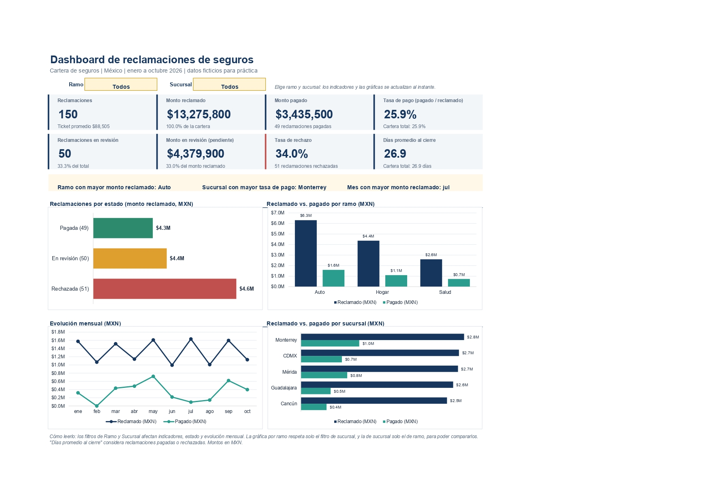
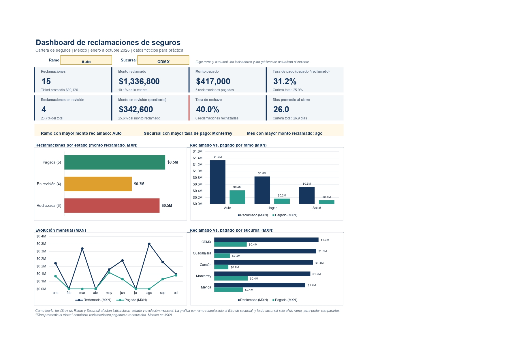

# Dashboard de reclamaciones de seguros

## Objetivo

Analizar volumen, costo y estado de reclamaciones para identificar cómo cambian los montos por mes y ramo, y qué parte de la cartera requiere seguimiento.

## Archivos

- dashboard_reclamaciones_seguros.xlsx: tablero y tabla de datos en Excel.
- outputs/dashboard_reclamaciones_seguros.jpg
- outputs/dashboard_reclamaciones_seguros_Seguros_autos_cdmx.jpg

## Indicadores

- Reclamaciones registradas.
- Monto reclamado y monto pagado, en pesos mexicanos.
- Días promedio de resolución para reclamaciones cerradas (pagadas o rechazadas).
- Reclamaciones en revisión.
- Distribución por estado, monto por ramo y evolución mensual de reclamado frente a pagado.

## Habilidades de Excel utilizadas

- Organización de registros en una tabla estructurada con encabezados, filtros y formatos adecuados para fechas, cantidades y moneda.
- Fórmulas de agregación y análisis: COUNTIF, SUMIF, SUMIFS, AVERAGEIF e IFERROR.
- Construcción de indicadores clave (KPI) con referencias a la tabla de datos.
- Análisis de fechas y agrupación de reclamaciones por mes.
- Creación de gráficos de participación, comparación y tendencia vinculados a los datos.
- Diseño de un dashboard con filtros interactivos por ramo y sucursal.
- Formato de números, jerarquía visual, títulos y paneles para facilitar la lectura.

## Datos y definiciones

La hoja Datos contiene 150 registros sintéticos de enero a octubre de 2026. Los importes, fechas, sucursales, productos y estados se generaron para practicar análisis; no pertenecen a una compañía ni describen resultados reales.

Una reclamación en revisión no tiene días de resolución ni monto pagado. Una reclamación rechazada puede tener días de resolución, pero su monto pagado es cero. La gráfica mensual compara el total reclamado con lo pagado en cada mes de reporte.

## Dashboard en general

## Hallazgo general

Con los filtros de ramo y sucursal en “Todos”, el dashboard muestra 150 reclamaciones por un monto total de $13,275,800 MXN. Se han pagado $3,435,500 MXN, equivalente al 25.9% del monto reclamado.

Hay 50 reclamaciones en revisión (33.3% del total), que representan $4,379,900 MXN pendientes, y 51 reclamaciones rechazadas (34%). En conjunto, cerca de dos tercios de los casos no aparecen como pagados. Esto hace relevante dar seguimiento al monto pendiente y revisar los motivos de rechazo.

Auto concentra el mayor monto reclamado por ramo y julio registra el mayor monto reclamado mensual. Estos resultados son ilustrativos: el dashboard utiliza datos ficticios y no representan el desempeño de una aseguradora real.

## Dashboard filtardo en autos de la CDMX

## Hallazgo: Auto en CDMX

Con los filtros de ramo = Auto y sucursal = CDMX, el tablero muestra 15 reclamaciones por un monto total de $1,336,800 MXN. Se pagaron $417,000 MXN, equivalente al 31.2% del monto reclamado.

La tasa de rechazo del segmento es 40% (6 de 15 casos), por encima del 34% observado en la cartera total. Además, hay 4 reclamaciones en revisión por $342,600 MXN. El tiempo promedio al cierre es de 26 días, frente a 26.9 días para la cartera.

Este resultado sugiere revisar los motivos de rechazo y dar seguimiento a los casos pendientes. Los datos son ficticios y la muestra del segmento es pequeña, así que el hallazgo es únicamente ilustrativo y no demuestra una causa ni un patrón real.

## Definiciones

- Tasa de pago: monto pagado dividido entre monto reclamado.
- Tasa de rechazo: reclamaciones rechazadas divididas entre reclamaciones del filtro.
- Días promedio al cierre: promedio de días de reclamaciones pagadas o rechazadas.
- Monto en revisión: monto reclamado de los casos que siguen pendientes.